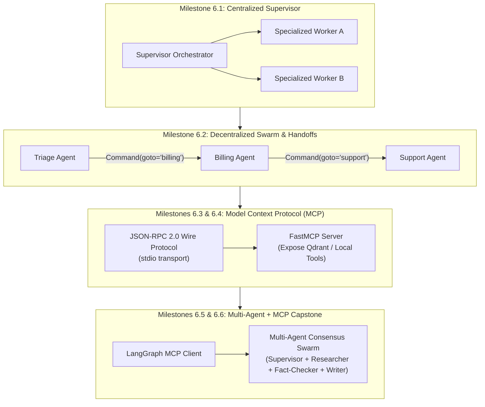
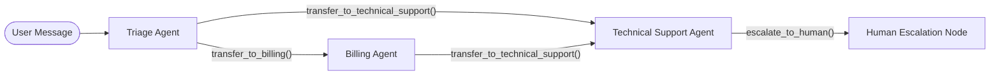
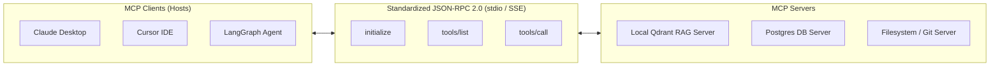
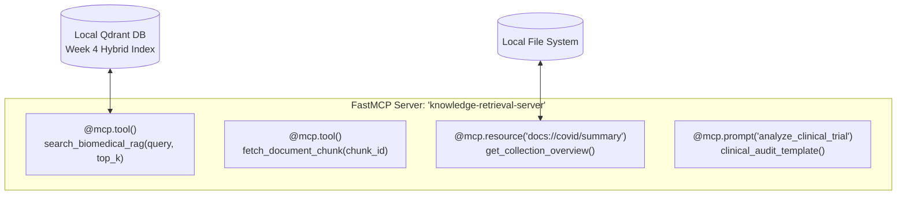
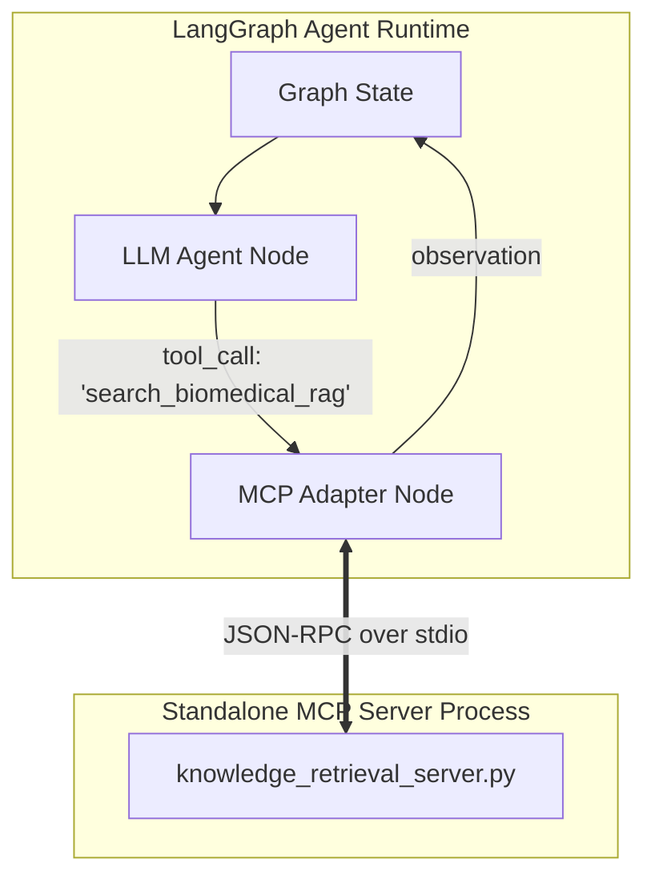
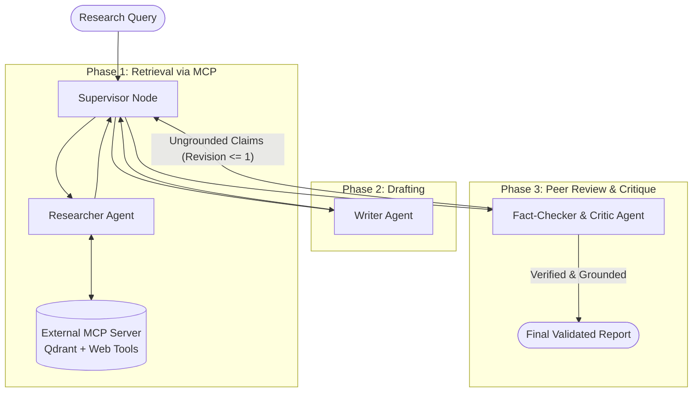

# Proposed Week 6 Execution Roadmap

Welcome to Week 6: **Multi-Agent Coordination & The Model Context Protocol (MCP)**.

In Weeks 1 through 5, you progressed from raw API calls and token dynamics to building custom RAG pipelines (hybrid BM25 + dense search, cross-encoder reranking, contextual retrieval) and autonomous single-agent state machines in LangGraph (Adaptive / Corrective RAG with self-reflection and Human-in-the-Loop checkpointing).

Now, Week 6 addresses the architectural ceiling of single-agent systems:
1. **Context & Tool Bloat**: A single agent given 15+ tools degrades in accuracy, suffers from prompt confusion, and floods its context window.
2. **The $M \times N$ Tool Integration Crisis**: Hardcoding tool schemas inside agent code locks tools into specific frameworks and prevents cross-client reuse (Claude Desktop, Cursor, IDEs, and CLI agents).

In accordance with our [Learning Methodology](file:///mnt/Storage/Projects/AI/study/LEARNING_METHODOLOGY.md), you will first master the underlying mechanics and failure modes natively before adopting high-level abstractions, and build a unified multi-agent system powered by standardized MCP servers.

---



---

## Milestone 6.1: The Limits of Monolithic Agents & The Centralized Supervisor Pattern

Deconstruct why single-agent architectures break at enterprise scale, and implement the industry-standard **Supervisor (Orchestrator-Worker)** architecture in LangGraph.

### The Problem:
Giving a single agent an expansive set of tools (e.g., SQL queries, vector search, web browsing, code execution, drafting) causes severe production failure modes:
1. **Tool Selection Degradation**: As the number of available tool schemas grows beyond 5–10, model precision in choosing the correct tool drops significantly, resulting in argument hallucinations and tool confusion.
2. **Context Window Exhaustion & Attention Dilution ("Lost in the Middle")**: Raw tool observations (especially multi-page web scrapes or vector search payloads) accumulate inside the single message list. Irrelevant intermediate observations dilute the model's focus on the user's primary goal.
3. **Persona Interference**: An LLM cannot effectively adhere to conflicting prompt instructions (e.g., "be an exhaustive, creative, divergent researcher" vs. "be a concise, skeptical, strict schema-validating editor") within a single context thread.

### The Solution:
**The Centralized Supervisor Topology (Orchestrator-Workers)**:
- A top-level **Supervisor Node** receives the user query, breaks the task down, and selects which specialized worker agent to delegate to.
- Each **Worker Agent** is an independent, isolated sub-agent (or LangGraph subgraph) with a dedicated system prompt and a small, highly curated set of tools.
- **State Isolation**: Workers execute their reasoning loops within their own local scratchpads and return only a concise, synthesized report back to the supervisor. This preserves parent context hygiene.

```mermaid
flowchart TD
    User([User Request]) --> Sup[Supervisor / Router Node]
    Sup -- "Delegate: 'research'" --> Res[Research Worker\n(Local Scratchpad)]
    Res -- "Summary Result" --> Sup
    Sup -- "Delegate: 'draft'" --> Draft[Drafting Worker\n(Local Scratchpad)]
    Draft -- "Summary Result" --> Sup
    Sup -- "Task Complete: FINISH" --> Output([Final Response to User])
```

### Concepts to Master:
- **Orchestrator-Worker vs. Sequential Chains**: When to use a central coordinator versus a static deterministic DAG.
- **Worker State Isolation vs. Shared State**: Why worker agents must NOT share a flat `Annotated[list, add_messages]` history with the supervisor (the "context leak" anti-pattern).
- **Structured Router Schemas**: Enforcing Pydantic router schemas with `Literal` next-step targets:
  ```python
  class RouterOutput(BaseModel):
      next_worker: Literal["researcher", "analyst", "FINISH"]
      instructions: str = Field(description="Specific assignment for the designated worker")
  ```
- **Loop Termination & Recursion Bounds**: Preventing supervisor-worker ping-pong cycles where the supervisor repeatedly sends tasks back without reaching a conclusion.

### Hands-on Task:
1. Create `agents/multi_agent_system/supervisor_pattern.py`.
2. Implement a 2-worker system coordinated by a central supervisor:
   - **Research Worker**: Equipped with web search / mock retrieval tools; explores facts and returns a synthesized brief.
   - **Analyst Worker**: Equipped with math / analysis tools; processes numerical data and calculates metrics.
3. Verify that the parent supervisor graph only stores the high-level exchanges, keeping total token usage compact compared to running a single agent with all tools combined.

---

## Milestone 6.2: Decentralized Coordination & Dynamic Agent Handoffs (Swarm Architecture)

Eliminate the supervisor bottleneck by allowing agents to transfer execution control directly to peers.

### The Problem:
While the Centralized Supervisor pattern works well for hierarchical tasks, it introduces major overhead in conversational or multi-domain routing workflows:
1. **The Double-Hop Latency Tax**: Every single transition requires a round-trip to the supervisor LLM. If an agent completes its job and knows exactly who should take over, forcing a return to the supervisor doubles latency and token cost.
2. **Context Translation Loss**: The supervisor must interpret the worker's output and re-prompt the next worker, potentially losing domain-specific nuances.

### The Solution:
**Decentralized Handoffs (Swarm / Peer-to-Peer Pattern)**:
- Popularized by OpenAI Swarm and natively supported in modern LangGraph via `Command(goto=..., update=...)`.
- Instead of returning to a central manager, an agent executes a **Handoff Tool** (e.g., `transfer_to_support`, `transfer_to_billing`) that transfers control directly to the target agent node.
- The target agent inherits the active conversation thread and continues execution seamlessly.



### Concepts to Master:
- **Handoffs as First-Class Tools**: How an agent triggers a routing transition using standard tool calling mechanisms.
- **LangGraph `Command` Primitive**: Using `Command(goto="target_agent", update={"messages": [...]})` to perform dynamic, runtime graph branching without rigid edge definitions.
- **Context Pruning During Handoff**: Deciding whether the receiving agent gets full conversation history, a summarized state, or only the latest message turn.
- **Decentralized Cycle Detection**: Mitigating "infinite ping-pong" failure modes (e.g., Agent A hands off to Agent B, which hands back to Agent A) through step counters in the state schema.

### Hands-on Task:
1. Create `agents/multi_agent_system/handoff_swarm.py`.
2. Build an intelligent customer triage workflow:
   - `TriageAgent`: Reads the user's initial message, handles small talk, or executes `transfer_to_billing` or `transfer_to_tech_support`.
   - `BillingAgent`: Has tools for invoices and refunds; can hand off to `TechnicalAgent` if the billing issue is caused by a technical glitch.
   - `TechnicalAgent`: Has diagnostic tools and can resolve or escalate.
3. Test a multi-turn scenario where the user starts with a technical issue, mentions a refund, and verify that handoffs transition smoothly without an intermediate supervisor call.

---

## Milestone 6.3: Under the Hood of Model Context Protocol (MCP) — Wire Protocol & JSON-RPC Mechanics

Learn the open standard that is replacing custom tool integrations across the AI industry. Build a native, zero-dependency client that talks to an MCP server at the raw wire-protocol level.

### The Problem:
Every agent framework (LangChain, LlamaIndex, CrewAI, AutoGen) has historically defined its own proprietary tool abstraction. This led to the **$M \times N$ Tool Integration Crisis**:
- To give 5 different agent environments access to 10 enterprise tools (databases, search, file systems, Git), developers had to write 50 bespoke tool wrappers.
- Tools were tightly coupled to the Python process running the LLM, creating security vulnerabilities, memory bloat, and dependency conflicts.

### The Solution:
**Model Context Protocol (MCP)**, open-sourced by Anthropic in late 2024:
- An open, universal standard based on **JSON-RPC 2.0**.
- Decouples tool execution from the agent. Tools run in independent server processes (written in Python, TypeScript, Go, etc.) communicating with clients via standardized transports (`stdio` for local processes, `SSE` / HTTP for remote microservices).
- Once an MCP server is built, it can be consumed immediately by Claude Desktop, Cursor, LangGraph, or any MCP-compliant client without modifying a single line of server code!



### Concepts to Master:
- **The 3 Core MCP Primitives**:
  1. **Tools**: Executable functions with JSON schema inputs that perform actions or retrieve dynamic data (model-controlled).
  2. **Resources**: URI-addressable, passive data sources (e.g., `file:///logs/app.log` or `postgres://schema/users`) that provide background context (application-controlled).
  3. **Prompts**: Reusable prompt templates and workflows exposed by the server for users or clients (user-controlled).
- **JSON-RPC 2.0 Wire Protocol**:
  - Request format: `{"jsonrpc": "2.0", "id": 1, "method": "...", "params": {...}}`
  - Response format: `{"jsonrpc": "2.0", "id": 1, "result": {...}}`
- **The MCP Lifecycle Handshake**:
  1. `initialize`: Client sends protocol version and capabilities; server responds with supported capabilities (tools, resources, prompts).
  2. `notifications/initialized`: Client acknowledges readiness.
  3. `tools/list`: Client discovers available tools, descriptions, and parameter schemas.
  4. `tools/call`: Client dispatches a function invocation with arguments and receives structured content blocks (`[{"type": "text", "text": "..."}]`).
- **Transport Mechanisms**: `stdio` (subprocesses communicating over standard input/output) vs. `SSE` (Server-Sent Events over HTTP for networked services).

### Hands-on Task (Phase 1 Native Wire Protocol):
1. Create `mcp_learning/native_mcp_wire_client.py`.
2. Write a pure Python script using only `subprocess`, `json`, and `sys` (no MCP SDKs yet):
   - Spawn a standard reference MCP server subprocess (or a basic JSON-RPC echo script) using `stdio`.
   - Send the raw JSON-RPC `initialize` handshake packet over `stdin`.
   - Parse the `initialize` response from `stdout`.
   - Send `tools/list` and inspect the returned OpenAPI/JSON parameter schemas.
   - Send a `tools/call` packet and extract the returned content payload.
3. Document how this JSON-RPC handshake maps directly to the raw tool calling payloads you examined in Milestone 5.1!

---

## Milestone 6.4: Building Production MCP Servers (Exposing Custom RAG & Tools via FastMCP)

Transition from the wire protocol to building modular, production-ready MCP servers using `FastMCP`. Expose your Week 4/5 RAG pipelines to the external world.

### The Problem:
Writing raw JSON-RPC dispatchers by hand is tedious, lacks input validation, does not generate OpenAPI schemas automatically, and requires manual process lifecycle management.

### The Solution:
**FastMCP (Python MCP SDK)**:
- A high-level, decorator-driven framework for building MCP servers (reminiscent of FastAPI).
- Uses Python type hints and Pydantic models to automatically generate valid MCP tool schemas, resources, and prompt templates.



### Concepts to Master:
- **`FastMCP` Server Setup & Decorator Syntax**: Registering tools (`@mcp.tool()`), resources (`@mcp.resource()`), and prompts (`@mcp.prompt()`).
- **Exposing Vector Search as an MCP Tool**: Wrapping Week 4's `HybridRetriever` (Qdrant Dense + BM25 + Cross-Encoder) inside a standalone MCP server process.
- **Resource URIs and Dynamic Templates**: Defining URI schemes (e.g., `biomedical://papers/{paper_id}`) that allow clients to directly inspect raw documents without invoking LLM tokens.
- **Client Configuration & Ecosystem Interoperability**:
  - Configuring `claude_desktop_config.json` to mount your local Python MCP server.
  - Interacting with your local Qdrant index directly from Claude Desktop or Cursor!

### Hands-on Task:
1. Create `mcp_servers/knowledge_retrieval_server.py` using `FastMCP`.
2. Implement and expose:
   - **Tool**: `search_biomedical_rag(query: str, top_k: int = 5)` — executes hybrid search over your Week 4 Qdrant collection and returns ranked text snippets.
   - **Tool**: `web_fallback_search(query: str)` — performs DuckDuckGo web search if local retrieval is insufficient.
   - **Resource**: `docs://collection/stats` — returns collection metadata (total chunks, embedding model, index status).
3. Test your server with the MCP CLI inspector (`npx @modelcontextprotocol/inspector`) or connect it to Claude Desktop / Cursor. Run queries and verify that the external desktop application calls your local Python code seamlessly!

---

## Milestone 6.5: Integrating MCP Clients into LangGraph Workflows

Bridge the external protocol world with your internal state machines. Build an agent that dynamically discovers and calls tools from external MCP servers.

### The Problem:
Now that you have built a standalone MCP server, how does an autonomous LangGraph agent use it?
- Hardcoding imports defeats the purpose of MCP.
- The agent needs to connect to one or more MCP servers dynamically at startup, query their capabilities, translate MCP tool definitions into LangChain / model tool bindings, and handle asynchronous process communication.

### The Solution:
**LangGraph MCP Client Architecture**:
- Use `mcp.ClientSession` or the official adapter libraries (`langchain-mcp-adapters`) to manage server subprocesses.
- Dynamically convert MCP tool definitions into model-compatible tool bindings (`bind_tools`).
- When the LLM decides to call a tool, route the invocation over the MCP client session to the external process and feed the observation back into the LangGraph state.



### Concepts to Master:
- **Asynchronous Client Lifecycles**: Managing `stdio_client` and `ClientSession` context managers in Python async event loops.
- **Dynamic Tool Schema Translation**: Converting MCP `Tool` objects (with JSONSchema input definitions) into `StructuredTool` or OpenAI function representations at runtime.
- **Fault-Tolerant Process Management**: What happens if an external MCP server crashes or hangs? Implementing timeouts and synthetic error payloads so the LangGraph graph never freezes.
- **Multi-Server Aggregation**: Connecting a single agent to multiple independent MCP servers (e.g., Server A = Local Qdrant Knowledge Base, Server B = Local File System or Git).

### Hands-on Task:
1. Create `agents/mcp_client/langgraph_mcp_agent.py`.
2. Write a LangGraph agent that:
   - Launches `knowledge_retrieval_server.py` as a managed subprocess at startup.
   - Automatically loads its tools using an MCP client session.
   - Binds the discovered tools to your model client (Groq / OpenAI).
   - Executes a research query where the model calls the external MCP tool and synthesizes the answer.
3. Implement defensive timeout handling: if the MCP server takes longer than 10 seconds to respond, intercept the call and return a graceful error message to the agent state.

---

## Milestone 6.6: Week 6 Capstone Deliverable — Multi-Agent Consensus & Research Swarm with MCP

Combine everything mastered across Weeks 4, 5, and 6 into a production-grade, multi-agent research, verification, and synthesis system.

### The Problem:
Single-agent research pipelines suffer from severe confirmation bias and hallucinated citations. If an agent retrieves data and immediately writes an answer, it frequently presents weak or irrelevant search snippets as factual evidence.

### The Solution:
**The Multi-Agent Consensus & Fact-Checking Swarm**:
An enterprise-grade, 4-agent collaborative architecture:
1. **Supervisor / Orchestrator**: Manages the high-level research plan, coordinates state transitions, and enforces strict recursion and budget bounds.
2. **Specialized Researcher Agent**: Connects via **MCP** to your local Qdrant RAG server and web search tools to gather domain evidence.
3. **Fact-Checker / Critic Agent**: Operates with a skeptical persona; inspects drafted claims against retrieved citations, grades source sufficiency, and flags ungrounded assertions.
4. **Technical Writer Agent**: Synthesizes the verified evidence into a clean, structured report with confidence ratings and reference footnotes.



### Key Architectural Safeguards:
- **Strict Revision Circuit Breaker**: The critic loop must be bounded (`max_critique_rounds = 1`). If a draft fails verification twice, the supervisor must stop cycling and output the draft with explicit caveats.
- **State Cleanliness**: Individual workers operate on localized state dicts. Only verified summaries and final drafts are elevated to the primary conversation state.
- **MCP Tool Decoupling**: All retrieval tools are hosted externally in the MCP server, demonstrating modular separation of concerns.

### Deliverables:
- Modular codebase in `agents/multi_agent_system/`:
  - `supervisor.py` — Orchestrator logic and routing schema.
  - `agents.py` — Researcher, Critic, and Writer node definitions.
  - `state.py` — Typed state schemas with isolated worker scratchpads.
  - `graph.py` — Complete LangGraph compilation with checkpointing.
- Comprehensive verification script demonstrating a complex research task (e.g., comparing clinical findings with live web context) executed with multi-agent critique and MCP tool resolution.

---

# Week 6 Study Notes

## Milestone 6.1: The Limits of Monolithic Agents & The Centralized Supervisor Pattern

- **"Why do monolithic single-agent systems degrade as tool counts grow, and what is the mathematical / architectural root cause?"**
    - **Tool Schema Bloat & Accuracy Collapse:** As an agent is equipped with more than 5–8 tools, the cumulative JSON Schema injected into the system prompt grows excessively. The model's attention weights must distribute over competing argument descriptions, leading to parameter hallucination, wrong tool selection, or failure to trigger tools.
    - **Context Window Pollution ($O(N^2)$ Token Compounding):** In a single ReAct loop, raw tool observations (e.g., 4 raw retrieval chunks, raw web scrape HTML) are dumped directly into the shared `messages` list. In subsequent turns, the agent must re-read all historical tool observations, degrading reasoning via the **"Lost in the Middle"** phenomenon and driving quadratic prompt token growth.
    - **Persona Interference:** An LLM cannot effectively adhere to diametrically opposed system instructions (e.g., "be an exploratory, divergent researcher" vs. "be a strict, skeptical mathematical auditor") inside a single context thread.


- **"What is State Isolation in multi-agent systems, and why is a shared global message list an anti-pattern?"**
    - **The Context Leak Anti-Pattern:** If worker agents share a flat `Annotated[Sequence[BaseMessage], add_messages]` state with the supervisor, the supervisor's context becomes flooded with the worker's internal trial-and-error attempts, intermediate retries, and verbose scratchpad logs.
    - **The Solution (Worker Scratchpads):** Workers execute within an isolated local state scope (subgraph or child agent). The worker performs its internal ReAct loop, filters noise, and passes only a concise, synthesized report back to the supervisor. The parent supervisor state retains only high-level managerial exchanges, keeping token usage compact and focus sharp.

- **"What is the 'Double-Hop Latency Tax' in the Centralized Supervisor pattern?"**
    - In a centralized supervisor pattern, **every single transition requires a round-trip to the supervisor LLM**.
    - If a user asks a query requiring research followed by mathematical analysis: $$
    \text{User} \to \text{Supervisor} \to \text{Researcher} \to \text{Supervisor} \to \text{Analyst} \to \text{Supervisor} \to \text{Finish}$$ Even if the Researcher completes its job and knows that calculations are required, it cannot transfer control directly to the Analyst. It must bounce back to the manager. This introduces extra network latency, serialization overhead, and prompt token spend at each hop (which Milestone 6.2's Swarm pattern directly eliminates).

- **"Why does returning an AIMessage from a worker to a supervisor trigger ValueError: Model does not support model prefilling on providers like Google Gemini?"**
    - **The Chat Completion Turn-Taking Invariant:** Chat completion wire protocols enforce alternating conversational roles: `user` $\to$ `model` $\to$ `user` $\to$ `model`.
    - When a worker finishes and returns `AIMessage(content=report, name="researcher")`, and the graph loops back to the supervisor, the message list ends on an `AIMessage`.
    - When the supervisor node calls `model.invoke()`, the provider sees that the final message in the prompt history is an assistant message. Gemini flags this as "Assistant Prefilling" (forcing the model to begin its response with specific tokens), which is disallowed on models like `gemini-3.5-flash-lite`.
    - **The Architectural Fix:** To the supervisor (the manager), a worker's report is an external observation / incoming update. Therefore, worker outputs must be formatted as `HumanMessage(content=..., name="researcher")` or `ToolMessage`, ensuring the conversation history cleanly alternates and terminates on a user turn.

- **"What causes an Infinite Supervisor-Worker Ping-Pong Loop, and how do you guarantee graph termination?"**
    - **The Failure Mode:** The supervisor's system prompt often contains static routing directives (e.g., "If numbers need calculation, delegate to analyst"). If the analyst computes the result and returns it, the supervisor reads the original user query, sees that it involves numbers, and blindly delegates to the analyst again!
    - **Mitigations:**
        - **Historical State Inspection:** Instruct the supervisor prompt explicitly: "Inspect conversation history. If an assigned worker has already satisfied the requirement, DO NOT call them again; select 'FINISH' and deliver the final answer."
        - **Structured Router Enums:** Enforce a strict Pydantic decision schema where FINISH is a first-class literal (`Literal["research", "analyst", "FINISH"]`).
        - **Graph Recursion Limits & Step Budgets:** Setting `recursion_limit` on the compiled LangGraph app (e.g., `app.invoke(..., config={"recursion_limit": 10})`) ensures execution halts with a `GraphRecursionError` rather than draining API budgets.

- **"Why did with_structured_output(method='json_mode') crash on Groq with BadRequestError: Tool choice is none, but model called a tool?"**
    - **The Wire Protocol Conflict:** When method="json_mode" is passed, LangChain configures the API payload with `response_format={"type": "json_object"}` and sets `tool_choice="none"`.
    - Models fine-tuned for tool use (such as Llama 3 or Qwen) in multi-turn conversations can emit function delimiters (e.g., `<|channel|>final` or `<function=...>`) inside their raw generated text tokens.
    - Because `tool_choice` was explicitly set to "none", the gateway proxy rejects the response as an invalid state.
    - **Best Practice:** Use default structured output (`with_structured_output(Schema)` without `json_mode`), which leverages native tool calling / function calling. Native tool calling is schema-validated, strictly typed, and supported across both Groq and Gemini.

- **"Why does 1 Graph Node transition NOT equal 1 LLM Call? (Macro vs. Micro Layers)"**
    - In hierarchical architectures, there are two distinct execution layers:
        - **Macro Layer (Graph Orchestration):** The transitions between nodes (supervisor $\to$ researcher $\to$ supervisor).
        - **Micro Layer (Worker Internal ReAct):** If a worker node is created using `create_react_agent`, that node runs its own internal sub-graph.
    - If a worker invokes a tool 3 times, that single worker node produces 4 internal LLM calls (3 reasoning turns + 1 final synthesis). A workflow appearing as 3 graph steps can easily generate 8–10 actual LLM invocations.

- **"What is the 'RAG Fallback Trap' in autonomous retrieval agents?"**
    - **The Fallacy:** Writing naive fallback logic:
        ```python
            results = retriever.search(query)
            if not results:
                results = web_search(query)
        ```
    - **The Reality:** High-dimensional vector databases and Cross-Encoder rerankers almost never return an empty list `[]`. They return the closest mathematical candidates in the collection (even if similarity is near zero or negative).
    - Because `results` is never empty, the web search fallback is never triggered. The internal ReAct worker reads the irrelevant chunks, recognizes that they do not answer the question, and enters a retry loop—rephrasing queries up to 5 times before exhausting its retry budget.
    - **Production Solution:** Implement **Score-Gated Routing**: check whether the top rerank score exceeds a relevance cutoff ($s > \tau$, e.g., $\tau = 0.2$). If the score is below the threshold, discard the local chunks and immediately trigger the web search fallback.

## Milestone 6.2: Decentralized Coordination & Dynamic Agent Handoffs (Swarm Architecture)


- **"What is the core difference between the Supervisor (Hub-and-Spoke) and Swarm (Peer-to-Peer) architectures?"**

    - **Supervisor Pattern:** A centralized manager sits at the center. Workers are isolated sub-agents that cannot talk to each other; they report exclusively back to the supervisor.
    - **Swarm Pattern:** Decentralized peer-to-peer network popularized by OpenAI Swarm. Agents hold domain tools plus handoff tools (`transfer_to_<agent>`). When an agent completes its sub-task, it transfers execution control directly to the peer agent without returning to a central manager.

- **"How does LangGraph's `Command(goto=..., update=...)` enable dynamic mesh routing?"**

    - Traditional state machines require static, pre-defined edges (`graph.add_edge("node_a", "node_b")` or rigid conditional edge dictionaries).
    - The `Command` primitive allows a node or tool to branch dynamically at runtime. By returning `Command(goto="target_agent", update={...})`, execution jumps directly to `"target_agent"`. The graph's topology becomes an adaptive mesh where edges are determined dynamically by model tool calls.

- **"What is Context Pruning in a Swarm, and why is unpruned state passing an anti-pattern?"**

    - **The Context Accumulation Problem**: In a naive Swarm, `state["messages"]` accumulates every raw tool observation (e.g., 4 DuckDuckGo search dumps) as execution hops across agents. In downstream nodes, the next agent inherits the entire conversation history, compounding prompt tokens quadratically ($O(N^2)$) and diluting model attention.
    - **Context Pruning**: When issuing a handoff, the emitting node strips out raw intermediate tool observations and passes only:
        1. The root user objective (`state["messages"][0]`).
        2. A clean handoff summary payload (HumanMessage(content="[Handoff]: ...")).
    - **Empirical Impact**: Context pruning reduced prompt token bloat from 12,925 tokens down to 1,369 tokens on identical tasks.

- **"Why does nested create_react_agent fail silently when a tool returns `Command(goto='external_node')`?"**

    - **The Subgraph Channel Scope**: `create_react_agent` compiles an isolated sub-graph containing only two private nodes: agent and tools.
        - If a tool inside this sub-graph emits `Command(goto="analyst")`, the inner runtime looks for "analyst" inside its own private namespace. Because "analyst" only exists in the parent graph, LangGraph warns: `Task tools wrote to unknown channel branch:to:analyst, ignoring it.`
        - **The Architectural Pattern**: Handoff tools must either return confirmation text strings inside subgraphs (with the parent node issuing the outer Command), or the swarm agents must be defined as peer nodes directly in the top-level graph.

- **"What is the Redundant ReAct Synthesis Turn during handoffs?"**

    - Standard ReAct agents follow a rigid turn structure: $\text{LLM Action} \to \text{Tool Observation} \to \textbf{LLM Synthesis}$.
    - When an agent calls a handoff tool, its intended action is to yield control immediately. However, if wrapped in a naive ReAct loop, the agent will execute an extra, useless LLM call attempting to "summarize" or respond to the handoff confirmation before transferring.
    - In production swarms, detecting a handoff tool call must act as an immediate short-circuit, intercepting execution and transferring control without generating unnecessary synthesis tokens.


- **"How do you prevent Infinite Ping-Pong Loops in decentralized swarms without a supervisor?"**

    - In a supervisor architecture, the manager enforces loop termination. In a swarm, Agent A can hand off to Agent B, which hands back to Agent A indefinitely.
    - **Mitigation (Decentralized Circuit Breakers)**:
        1. Maintain an integer `handoff_count` in the typed state schema with an accumulator reducer (`current + increment`).
        2. Enforce a hard ceiling (`MAX_HANDOFFS = 3` or `6`).
        3. If `handoff_count >= MAX_HANDOFFS`, the node disables handoff tools and forces the current agent to synthesize the best possible answer from available context.