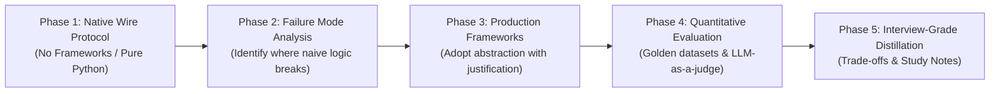
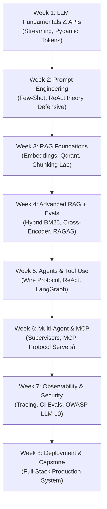

# AI Engineering Study Blueprint & Learning Methodology

> **Target Audience / Agent Directive**: 
> This document defines the exact learning philosophy, syllabus dependency architecture, and project evaluation methodology used throughout this repository. Any AI agent assisting in this project **MUST** read this file first to understand how to guide the student, review code, structure roadmaps, and format study notes.

---

## 1. Core Learning Philosophy: The 5-Phase Cycle

The core principle of this project is: **Never use a framework abstraction until you have built and broken the underlying mechanism natively.**

Every topic across the syllabus is mastered through a strict 5-phase progression:



### Phase 1: Native Wire Protocol First (Under-the-Hood Mechanics)
- Avoid importing high-level wrappers (`LangChain`, `LlamaIndex`, `CrewAI`) at the start of a topic.
- Implement the raw mechanics first using standard libraries, native SDKs (`groq`, `openai`), and `pydantic`.
- *Examples in this repo*:
  - Native function calling at the HTTP payload level (`agents/native_tool_calling/agent_runner.py`).
  - Manual reciprocal rank fusion (RRF) math ($k=60$) before using framework retrievers.
  - Raw embedding generation and vector distance calculations before automated ingestion pipelines.

### Phase 2: Failure Mode & Edge-Case Stress Testing
- Intentionally test where the naive or simple implementation breaks in production scenarios.
- Identify the exact architectural limitation before reaching for a library:
  - *Dense vectors fail on acronyms & IDs* $\to$ Necessitates Sparse BM25 + Hybrid Search.
  - *Fixed-size chunking isolates table rows from headers* $\to$ Necessitates Structure-Aware Chunking.
  - *Handling only `tool_calls[0]` violates OpenAI wire protocol on parallel calls* $\to$ Necessitates Parallel Tool Orchestration.
  - *Raw while-loops suffer from infinite thrashing, context pollution, and zero state recovery* $\to$ Necessitates LangGraph State Machines.

### Phase 3: Framework Adoption with Architectural Justification
- Only after the limitation is demonstrated is a production framework introduced (e.g., Qdrant native hybrid indexing, LangGraph state machines, FastEmbed).
- The framework is treated not as "magic", but as an industrial solution to the specific failure modes discovered in Phase 2.

### Phase 4: Quantitative Evaluation & Benchmarking
- An implementation is not complete until it is quantitatively measured.
- Always implement an evaluation-first mindset:
  - Golden test datasets (e.g., `golden_dataset/covid_6page.json`).
  - Standardized metrics (RAGAS: Faithfulness, Answer Relevance, Context Precision, Context Recall).
  - Empirical scorecards (`evaluation/ragas_scorecard.csv`) comparing baseline vs. enhanced approaches.

### Phase 5: Interview-Grade Distillation (`study/` Notes)
- Every concept must be translated into an interview-ready mental model.
- Document the trade-offs, asymptotic complexities, failure mitigations, and architectural alternatives in `study/{N}th-week.md`.

---

## 2. Complete Syllabus Lineage & Inter-Week Dependencies

The curriculum is structured so that **every week takes the artifacts of earlier weeks and turns them into components or tools for higher-level systems**.



### Detailed Breakdown of Weekly Connections

#### Week 1: LLM Fundamentals + API Mastery
- **What it Teaches**: Raw token dynamics, context windows, multi-provider API calls (Groq, OpenAI, Gemini), streaming handlers, Pydantic response formatting.
- **Backward Link**: Starting point (Python fundamentals $\to$ LLM wire protocol).
- **Forward Link**: Provides the structured I/O and streaming clients needed for all prompt pipelines in Week 2 and tool parsers in Week 5.

#### Week 2: Prompt Engineering for Production
- **What it Teaches**: System prompt architecture, few-shot conditioning, chain-of-thought, defense against injection, defensive output validation.
- **Backward Link**: Builds on Week 1 Pydantic parsing and API completions.
- **Forward Link**: Powers the system prompts for RAG synthesizers (Week 3/4) and agent reasoning traces (Week 5).

#### Week 3: RAG Foundations (The Ingestion & Storage Layer)
- **What it Teaches**: High-dimensional vector embeddings, vector databases (Qdrant), chunking strategies (naive, recursive, structure-aware).
- **Backward Link**: Uses Week 1 embedding calls and Week 2 prompt formatting for answering questions over context.
- **Forward Link**: The vector database and chunks built here form the raw retrieval substrate enhanced in Week 4.

#### Week 4: Advanced RAG + Evaluation (The Retrieval Precision Layer)
- **What it Teaches**:
  - *Hybrid Search*: Sparse BM25 + Dense vector search combined with Reciprocal Rank Fusion ($k=60$).
  - *Reranking*: Bi-encoder retrieval followed by Cross-Encoder re-scoring.
  - *Pre-Retrieval*: Anthropic contextual retrieval and query rewriting / HyDE.
  - *Evaluation*: RAGAS golden-dataset benchmarking.
- **Backward Link**: Directly upgrades Week 3's naive vector search.
- **Forward Link**: These retrieval pipelines are **not discarded**; in Week 5.4, they are wrapped as tools for the Agentic RAG system!

#### Week 5: Agents + Tool Use (The Autonomous Reasoning Layer)
- **What it Teaches**:
  - *5.1 Native Tool Calling*: Pydantic reflection, OpenAPI schemas, parallel tool calls, wire-protocol alignment.
  - *5.2 ReAct & Loop Failure Modes*: Thought-Action-Observation loops, cycle detection, context window pollution, state loss in raw loops.
  - *5.3 LangGraph Fundamentals*: State machines, typed schemas, deterministic nodes, conditional routing edges.
  - *5.4 Agentic RAG (Self-RAG / Adaptive RAG)*: Converting Week 4's hybrid retriever and query transformer into dynamic agent tools with retrieval self-grading.
  - *5.5 Memory & HITL*: Checkpointers (`MemorySaver`/`SqliteSaver`), thread IDs, breakpoint interrupts for human approval.
  - *5.6 Capstone*: Autonomous multi-step research agent.
- **Backward Link**: Integrates Week 1 (Pydantic), Week 2 (Reasoning prompts), and Week 4 (Hybrid retriever as a tool).
- **Forward Link**: The single-agent state machines built here become the individual worker nodes in Week 6's multi-agent workflows.

#### Week 6: Multi-Agent + MCP (The Coordination & Protocol Layer)
- **What it Teaches**: Supervisor patterns, agent handoffs, Model Context Protocol (MCP) clients and servers.
- **Backward Link**: Takes Week 5 single-agent state graphs and coordinates them across specialized domains.
- **Forward Link**: Multi-agent systems generate complex distributed traces that demand Week 7's observability and security guardrails.

#### Week 7: Observability + Guardrails + Security (The Production Hardening Layer)
- **What it Teaches**: Langfuse/LangSmith execution tracing, LLM-as-a-judge CI pipelines, OWASP LLM Top 10 defenses, semantic caching.
- **Backward Link**: Wraps around the agents and RAG pipelines built in Weeks 4, 5, and 6 to make them production-safe.
- **Forward Link**: Prepares the hardened system for containerization and cloud deployment in Week 8.

#### Week 8: Deployment + Fine-Tuning Intro + Capstone
- **What it Teaches**: FastAPI serving, Dockerization, streaming endpoints, production deployments, and domain fine-tuning foundations.
- **Backward Link**: Packages the entire journey into a shippable product portfolio.

---

## 3. Standard Architecture of Study Documentation (`study/{N}th-week.md`)

Each week's study file in the `study/` directory must follow a consistent, high-standard structure divided into two distinct sections:

### Section 1: Proposed Execution Roadmap
Divided into sequential milestones (e.g., Milestone 5.1, 5.2, 5.3):
- **The Problem**: What real-world production problem or failure mode are we addressing?
- **The Solution**: What architectural pattern or mathematical principle solves it?
- **Concepts to Master**: Explicit theoretical topics, papers, or specifications.
- **Hands-on Task**: Specific implementation steps and verification experiments.

### Section 2: Study Notes & Interview Drill Questions
Divided by milestone/episode:
- Phrased as **real technical interview questions** asked by senior engineering interviewers at top AI product companies.
- Answers must provide:
  1. *First-principles explanation* (avoiding generic buzzwords).
  2. *Architectural trade-offs* (e.g., latency vs. accuracy, cost vs. precision, memory vs. compute).
  3. *Concrete numerical/mathematical anchors* (e.g., $k=60$ in RRF, $O(N)$ transformer attention in cross-encoders, context window degradation curves).

---

## 4. Current Repository Directory Structure & Artifact Map

When exploring or reviewing the project, agents should navigate the codebase using this structural map:

```
AI/
├── study/                        # Core theoretical blueprints & interview Q&As
│   ├── LEARNING_METHODOLOGY.md   # [THIS FILE] Core study guide & agent protocol
│   ├── 4th-week.md               # Advanced RAG, Hybrid search, RAGAS notes
│   └── 5th-week.md               # Tool calling, ReAct, LangGraph, Agentic RAG notes
├── basic_llm/                    # Weeks 1 & 2: Raw API calls, tokens, streaming, prompts
├── resume_score/                 # Week 2: Structured extraction pipeline project
├── rag/                          # Week 3: Naive RAG, basic embeddings
├── vector_db_rag/                # Week 3: Local Qdrant integration
├── chunking_comparison_lab/      # Week 3: In-depth chunking strategy experiments
│   ├── strategies/               # Naive, recursive, structure-aware implementations
│   ├── golden_dataset/           # Ground-truth Q&A pairs for evaluation
│   └── ToDo.md                   # Lab experiments, table chunking dilemmas
├── hybrid_rag/                   # Week 4: Dense + Sparse BM25 retrieval, Cross-Encoder reranking
├── pre_retrieval/                # Week 4: Query transformation (HyDE, decomposition), Contextual retrieval
├── evaluation/                   # Week 4: RAGAS evaluation pipeline & CSV scorecards
├── agents/                       # Week 5+: Autonomous agents & workflows
│   └── native_tool_calling/      # 5.1: Wire-protocol, Pydantic schemas, parallel tool runner
└── utils/                        # Shared multi-provider LLM abstraction layer & configurations
```

---

## 5. Agent Operating Protocol (Instructions for Assisting the Student)

When any AI assistant is given a task in this repository:

1. **Check Git History & Past Notes First**:
   - Run `git log -n 5 --oneline` to see the latest milestone achieved.
   - Read the relevant `study/{N}th-week.md` to see what concepts were already mastered and what is upcoming.
2. **Respect the Native $\to$ Framework Progression**:
   - Do NOT immediately suggest third-party wrappers or libraries unless the syllabus milestone specifically calls for them.
   - Always explain how the wire protocol or raw logic works first.
3. **Lead with Failure Modes**:
   - Before recommending an architectural pattern, clearly articulate *how and why* simpler approaches fail in production.
4. **Connect Backward and Forward**:
   - Explicitly highlight how the current milestone reuses components from previous weeks and prepares components for future weeks.
5. **No Code Unless Explicitly Requested**:
   - When asked for descriptions, roadmaps, or conceptual explanations, focus purely on architecture, mental models, failure modes, and interview questions. Do not bloat responses with unsolicited code.

